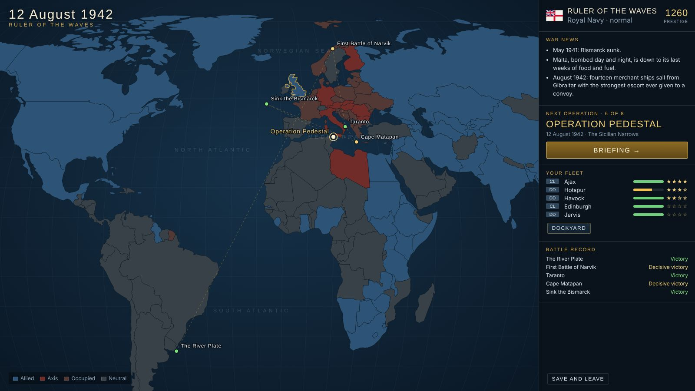
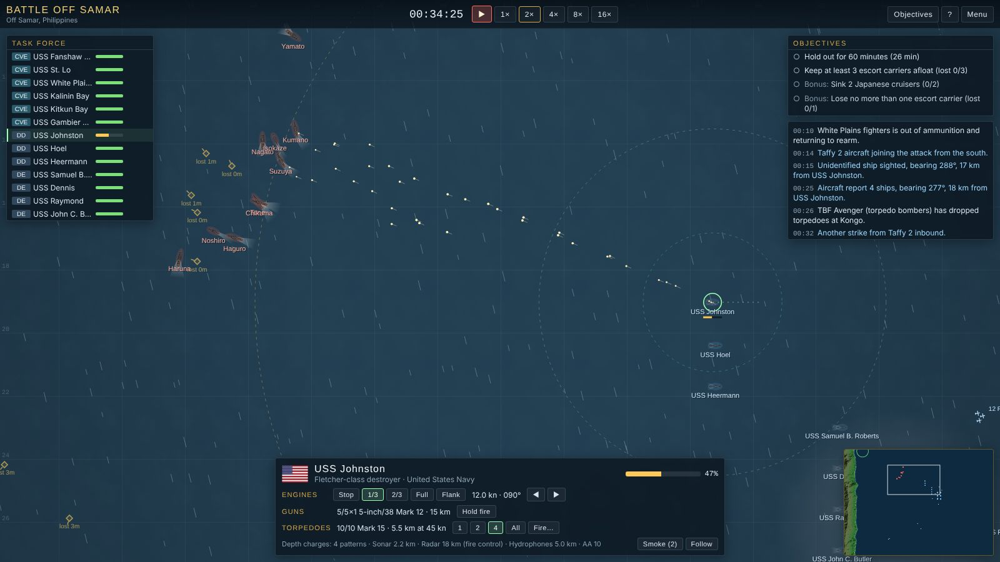

# Silent Bearing III

A top-down 2D naval strategy game of the Second World War that runs in the browser.

Choose a navy and fight its war, from the first months to the last. The Royal Navy, the US Navy, the Kriegsmarine and the Imperial Japanese Navy each have their own campaign of eight historical battles. A world map shows the war turning around you between battles. The ships you keep alive carry over from one battle to the next: they take damage, they get repaired, and their crews gain experience.

**Play:** <https://nrobertson152.github.io/Silent-Bearing-3/>. There is also a [single-file version](https://nrobertson152.github.io/Silent-Bearing-3/silent-bearing-3.html) you can save and play offline.





## The campaigns

| Campaign | Navy | Battles |
| --- | --- | --- |
| **Ruler of the Waves** | Royal Navy | The River Plate · First Battle of Narvik · Taranto · Cape Matapan · Sink the Bismarck · Operation Pedestal · Convoy ONS 5 · Battle of the North Cape |
| **Pacific Thunder** | United States Navy | Balikpapan · The Coral Sea · Midway · Naval Battle of Guadalcanal · Convoy College · Surigao Strait · Battle off Samar · Radar Picket Station One |
| **Grey Wolves** | Kriegsmarine | Scapa Flow · Operation Juno · The Happy Time · The Denmark Strait · The Channel Dash · Battle of the Barents Sea · Black May · Battle of the North Cape |
| **The Long Lance** | Imperial Japanese Navy | Battle of the Java Sea · Indian Ocean Raid · Midway · Battle of Savo Island · I-19's Salvo · Battle of Tassafaronga · Battle off Samar · Operation Ten-Go |

Every battle can also be fought on its own, with the historical forces, from **Historical battles**.

## What a battle is like

- **Real time, with pause.** Orders can be given while paused, and time runs at up to 16×. Select ships, steer them with right-click, set their speed, and pick their targets.
- **You only see what your ships see.** Lookouts, radar, sonar, hydrophones, HF/DF and aircraft each report contacts. Night, rain, fog and smoke shorten visual range. Each class gets radar from about the year it really did. Hydrophones give only a bearing. Two bearings that cross give a position.
- **Gunnery.** Guns build up a firing solution salvo by salvo. A hard turn by either ship spoils it. Plunging fire at long range can find a magazine.
- **Torpedoes.** They run straight and slowly, so aim ahead of the target and spread the salvo.
- **Carriers and aircraft.** Strikes fly to where the enemy was last reported. Scouts search, fighters fly CAP and dogfight until their ammunition runs out, and anti-aircraft fire breaks up attacks. A carrier caught with armed aircraft on deck burns.
- **Submarines and escorts.** A boat on the surface is fast but easy to see. Submerged, she is slow and her battery runs down. Escorts hunt with sonar and depth charges, and later with Hedgehog.
- **The campaign.** Battles earn prestige for objectives and sinkings. Spend it in the dockyard on repairs and on new construction as each class enters service. Ships gain veterancy, and ships that are lost stay lost. A defeat can be retried, or accepted so that the war moves on.

Every ship, coastline, explosion and sound is generated in code. There are no image or audio files. The world map is drawn from Natural Earth country outlines in the [`world-atlas`](https://github.com/topojson/world-atlas) package.

## Controls

| | |
| --- | --- |
| Left-click / drag | select a ship / box-select (Shift adds) |
| Right-click | move there (Shift queues waypoints), engage an enemy, or form on a friendly ship |
| Right- or middle-drag, wheel | pan and zoom (pinch and drag on a touchscreen) |
| Space | pause; `[` and `]` change the time speed |
| 1–5, Q/E | Stop, 1/3, 2/3, Full, Flank; slower/faster |
| Z / C | come left / right 15° |
| T, Y | torpedo attack; change the spread |
| H, M | hold fire; smoke screen |
| R / F | submarine shallower / deeper |
| B | launch a carrier strike |
| Tab, G, V | next ship, centre on her, follow her |
| F1 | all the controls |

## Building it

You need Node.js 22.12 or later.

```sh
npm ci
npm run dev           # play at http://localhost:5173
npm test              # data checks, determinism, and every mission played AI against AI
npm run build         # the site, in dist/
npm run build:single  # everything in one HTML file, in dist-single/
```

The code is TypeScript with no framework: an HTML5 canvas for the battle and plain DOM for the screens. [`AGENTS.md`](AGENTS.md) describes the layout of the source, how changes are made and reviewed, and the rules they follow. In short, the simulation is deterministic, the game has no binary assets, and old saves keep loading.

## Licence

[GPL-3.0](LICENSE)
